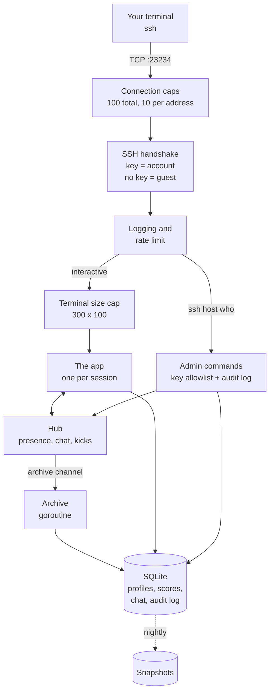
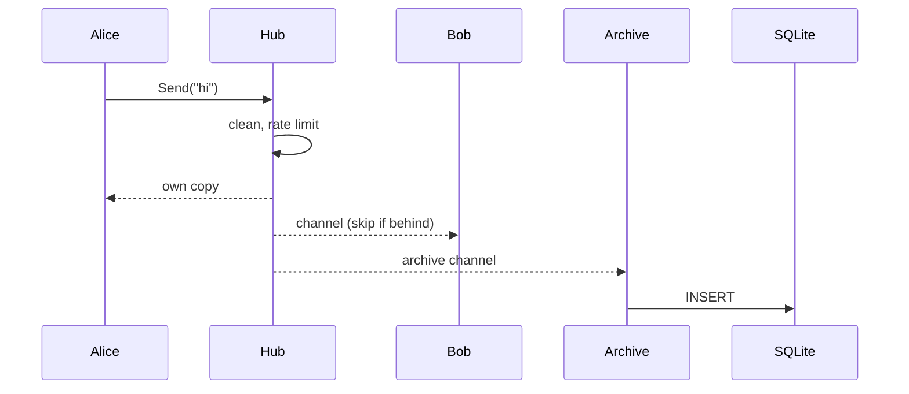
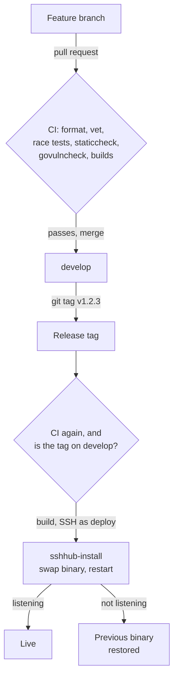

# sshhub

A little online hangout that lives in your terminal. Play trivia and snake, chat with whoever's around, browse ASCII art memes and climb the leaderboard. Nothing to install: if you have a terminal, you're one command away.

```sh
ssh -p 23234 dibe-ssh-hub.duckdns.org
```


## What's inside

**Chat lobby**: live chat with everyone connected, plus a list of who's online: chatting (●) or somewhere else in the hub (○). The last 100 messages are waiting for you when you join.


<table>
  <tr>
    <td width="50%"><b>Trivia</b>: 10 random questions from a bank of 100+, 15 seconds each, faster answers score more.<br><br></td>
    <td width="50%"><b>Snake</b>: the classic. It speeds up with every apple.<br><br></td>
  </tr>
  <tr>
    <td width="50%"><b>Meme gallery</b>: ASCII art tech memes, browse with ←/→.<br><br></td>
    <td width="50%"><b>Leaderboard</b>: best score per player, one tab per game.<br><br></td>
  </tr>
  <tr>
    <td width="50%"><b>Settings</b>: pick a theme, change your nickname, or wipe your scores (asks first).<br><br></td>
    <td width="50%"><b>Themes</b>: six color schemes, saved with your profile:<br><br>
      <b>Racing Green</b> (default) · <b>Rosso Corsa</b> · <b>Papaya</b> · <b>Silver</b> · <b>Midnight</b> · <b>Racing Blue</b><br><br>
      <sub>Inspired by the historic national racing colors and motorsport color traditions.</sub></td>
  </tr>
</table>

## How to join

SSH is the tool programmers use to log in to servers. Here it opens the hub instead, and the hub is all you can reach: there's no access to the server behind it.

1. Open a terminal:
   - **Windows 10 or 11**: PowerShell or Windows Terminal (SSH is built in).
   - **macOS**: the Terminal app.
   - **Linux**: any terminal.
   - **Phone**: an SSH app such as Termius.
2. Run `ssh -p 23234 dibe-ssh-hub.duckdns.org`.
3. The first time, SSH asks whether you trust the server. Type `yes`. To be thorough, check the fingerprint it shows is `SHA256:OmGMW7AavE9TTN+PPEzdXjk4KRo3ihYJXo8R52cBZ9g`.
4. Use the arrow keys or numbers to move around, Enter to pick, Esc to go back, `q` to leave.

**Your account is your SSH key.** If you have one (most developers do), the hub recognizes you every time: you pick a nickname once, and your scores and theme are saved. No passwords, no sign-up.

**No key? You're a guest.** You can do everything, but nothing is saved, and your name is whatever you put before the `@`:

```sh
ssh -p 23234 -o PubkeyAuthentication=no yourname@dibe-ssh-hub.duckdns.org
```

To get a key, run `ssh-keygen -t ed25519` once and press Enter at every question.

One session at a time: logging in again (same key, or as a guest from the same address with the same name) closes your older session. In Settings you can change your nickname (your scores follow you) or clear your scores.

---

## How it works

Everything is a single Go program. It speaks SSH itself, so it doesn't need the server's own SSH or a shell: each connection gets its own instance of the app, drawn with [Bubble Tea](https://github.com/charmbracelet/bubbletea), while the things everyone shares (who's online, the chat) live in one place in memory. Persistent data is in SQLite.



The hub is guarded by a single mutex. Each chat member has a buffered channel; a message is handed to every channel and to the archive goroutine without ever waiting, so one slow connection or a slow disk can't hold up the chat. A reader that falls too far behind skips messages instead:



Stopping the server (Ctrl+C, SIGTERM, `systemctl restart`) tells everyone the hub is restarting and gives them a few seconds to see it, then lets the archive finish before the database closes.

### Project layout

```
main.go                wiring: flags, middleware, startup and shutdown
internal/app           the app: one Bubble Tea model per session, a screen per page
internal/hub           shared state: who's online, the chat, kicks and announcements
internal/store         SQLite: schema, migrations, queries
internal/admin         admin commands over SSH
internal/limit         connection caps and the terminal size cap
internal/backup        database snapshots and pruning
assets/                trivia questions and memes, embedded into the binary
deploy/                systemd units, server setup, deploy and CI key scripts
scripts/screenshots/   regenerates the screenshots in this README
```

### Run it yourself

```sh
go build -o sshhub .
./sshhub                 # listens on :23234, creates hub.db and .ssh/id_ed25519
ssh -p 23234 localhost
```

The repo pins its Go version in `go.mod`; with Go 1.21 or newer installed, the right toolchain is downloaded automatically.

| Flag | Default | |
|---|---|---|
| `-addr` | `:23234` | listen address |
| `-db` | `hub.db` | SQLite database |
| `-hostkey` | `.ssh/id_ed25519` | server key, created if missing |
| `-dev` | off | allow several sessions per person, for local testing |
| `-max-conns`, `-max-conns-per-ip` | 100, 10 | connections open at once |
| `-admin-keys` | none | authorized_keys file of admins (see [Administration](#administration)) |
| `-backup DIR`, `-keep N` | | snapshot the database and host key into DIR, keep N, exit |
| `-version` | | print the version and exit |

### Security

It's a public server anyone can reach, so:

- **Nobody gets a shell.** Every connection lands in the app; admins get a fixed list of commands.
- **Resource caps.** At most 100 connections, 10 per address, and a rate limit on new sessions. Terminal sizes are capped at 300 × 100 cells: drawing costs memory with every cell, and without the cap a single visitor claiming a giant window could run the server out of memory. With every connection at the cap, the server stays well inside its memory limit (measured).
- **Clean input.** Chat strips control characters, so nobody can send escape sequences to other people's terminals; nicknames are letters, digits, `_` and `-`.
- **A sandboxed service.** It runs as its own user, can only write its data directory, and has no capabilities or access to other processes (`systemd-analyze security` rates it 1.4, "OK").
- **Accountable admins.** Admin keys live in a root-owned file outside the app's reach, and every command is written to an audit log before it runs, or doesn't run.
- **A narrow deploy key.** CI's key can only install a new binary (details below).

## Administration

Keys listed in the server's `/etc/sshhub/admin_keys` (authorized_keys format, owned by root) can run commands by connecting with one:

```sh
ssh -p 23234 dibe-ssh-hub.duckdns.org who                  # sessions: id, nick, where, for how long, address
ssh -p 23234 dibe-ssh-hub.duckdns.org kick 7               # or kick NICK
ssh -p 23234 dibe-ssh-hub.duckdns.org broadcast restarting in 5 minutes
ssh -p 23234 dibe-ssh-hub.duckdns.org stats                # version, uptime, sessions, memory
ssh -p 23234 dibe-ssh-hub.duckdns.org audit                # the last admin commands
```

The file is read on every command, so adding or removing a key applies at once. Anyone else gets the same refusal whatever they type. `broadcast` shows a banner on every screen for 15 seconds and posts it in the chat.

## Releasing and operations

### Workflow



- Work on a branch and open a pull request into `develop`. CI has to pass and the branch has to be up to date before it can merge.
- To release, tag a commit on `develop`. The hub then shows the tag as its version:
  ```sh
  git switch develop && git pull
  git tag -a v0.2.0 -m "v0.2.0" && git push origin v0.2.0
  ```
- Nobody pushes to `develop` directly, force-pushes or deletes it, and release tags can't be moved or deleted (repository rulesets).

The deploy job pipes the binary over SSH to the server as the `deploy` user, whose key can do exactly one thing: run `sshhub-install`. That script accepts only an executable for the server's architecture, keeps the previous binary, restarts the hub and rolls back if it doesn't start listening. The key is a secret of the `production` environment, which only release tags can use; the server's host key is pinned, the actions the job runs are pinned to commits, and it builds without any cache. `deploy/ci-key.sh` creates or rotates the key.

To get a Telegram message when CI fails or a deploy finishes, create a bot with @BotFather and add `TELEGRAM_BOT_TOKEN` and `TELEGRAM_CHAT_ID` as repository secrets.

### Server

`deploy/deploy.sh` sets up and looks after a Linux server (amd64 or arm64) over SSH. The hub runs as the `sshhub` systemd service with its database and host key in `/var/lib/sshhub`.

```sh
deploy/deploy.sh                    # set up the server (users, units, firewall), build, install, restart, check
deploy/deploy.sh --rollback         # back to the previous binary
deploy/deploy.sh --pull-backup      # back up now and copy the snapshot and host key to ./backups
deploy/deploy.sh --restore FILE     # put a snapshot back (the replaced database is kept next to it)
deploy/deploy.sh --add-admin [KEY]  # let a public key run admin commands (default ~/.ssh/id_ed25519.pub)
```

CI only ships the binary; changes to the systemd units, firewall or users go out with `deploy/deploy.sh`. To roll back to an older release, check out its tag and run `deploy/deploy.sh`.

`HOST` picks the server (an SSH destination with sudo) and `PORT` the hub's port. On a cloud VM, the provider's firewall (for Oracle Cloud, the subnet's security list) has to allow the port too. Logs: `journalctl -u sshhub -f`.

**Backups**: a systemd timer snapshots the database every night with `VACUUM INTO` (safe while the hub runs), checks the copy's integrity, keeps the last 14 in `/var/lib/sshhub/backups`, and copies the host key next to them. Losing the host key would make every visitor's SSH warn that the server's identity changed. Snapshots on the same disk don't survive losing the server, so pull one now and then.

## Adding content

- **Trivia**: edit `assets/questions.json` (`answer` is the index into `choices`; choices are shuffled at runtime).
- **Memes**: drop `.txt` files of classic ASCII art into `assets/memes/`. A leading `NN-` sets the order. The tests keep them to plain ASCII, at most 70 columns by 20 lines.

Assets are embedded into the binary, so rebuild after changes.

## Screenshots

`scripts/screenshots/screenshots.sh` regenerates the images in `docs/screenshots/`. It runs a demo server with seeded players and chat bots, and records a scripted SSH session with [VHS](https://github.com/charmbracelet/vhs) in headless Chrome, so nothing opens on your desktop. Needs `vhs`, `ttyd`, `ffmpeg` and Chrome or Chromium.
